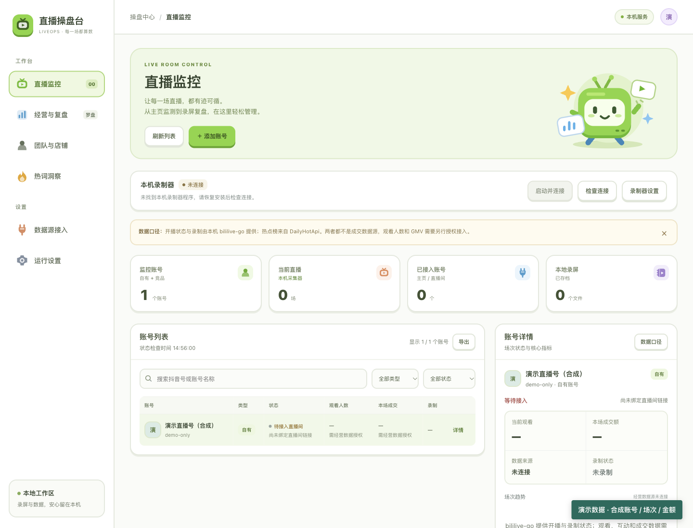
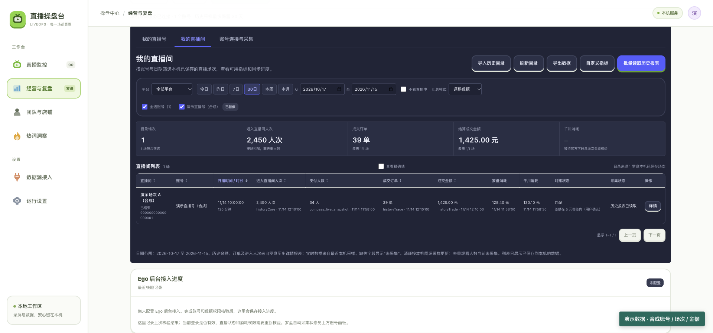
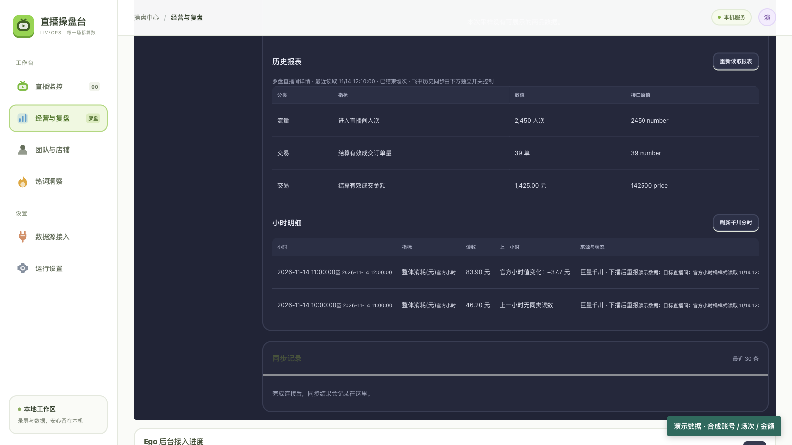
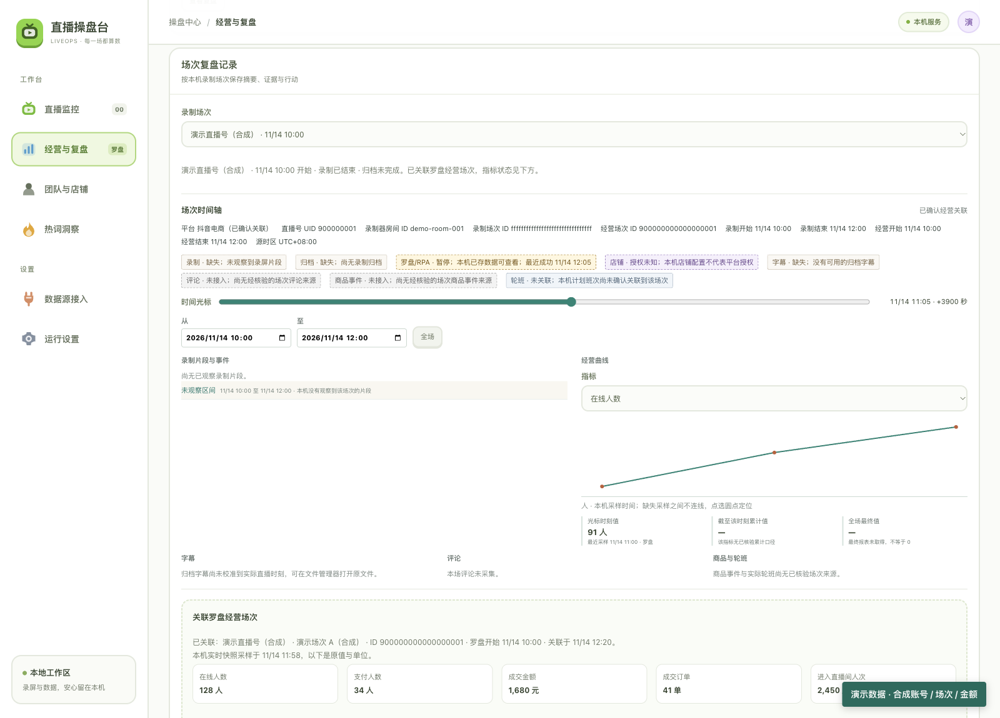
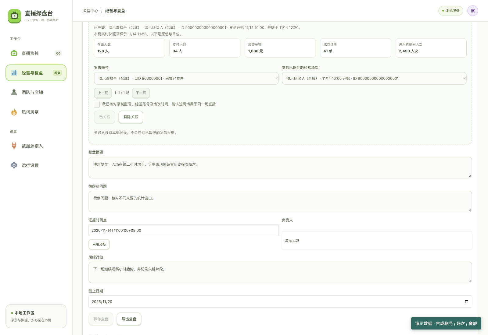

# 直播操盘台 · LiveOps Workbench

本机运行的直播经营工作台，在一个网页中管理直播监控、录屏后处理、经营复盘和可选的数据同步。

源码公开（source-available），仅限非商业使用。授权范围见 [LICENSE](LICENSE)。

运行流程不依赖 Codex 或云端大模型 API；转写与关键词分析使用本地模型，不产生按模型 token 计费的调用。抖音、罗盘、热点榜数据获取和飞书同步仍需联网。零云端模型 token 消耗的独立运行验收标准见 [功能路线图](docs/ROADMAP.md)。

**当前版本是持续开发基线，尚未完成全部功能与真实业务验收。** 开发范围、优先级和逐项验收见 [功能路线图](docs/ROADMAP.md) 与 [技术架构](docs/ARCHITECTURE.md)。

## 当前能力

- 直播账号管理，粘贴抖音主页链接后可自动检测开播并交给 bililive-go 监测 / 录制；支持录制器控制和录屏列表。
- 录屏完成后压缩，验证成功后按设置删除对应原文件，保留压缩视频；可用 whisper.cpp 生成 TXT / SRT。
- 后处理支持失败重试及服务重启后继续；可单独恢复 FLV 最后一个 H.264 残包。恢复操作保留损坏原件，生成视频仍须严格校验，不补回断流画面。
- 场次页支持本地字幕搜索、片段内时间码、查看字幕、搜索结果 CSV 导出和系统文件管理器定位；视频已移走时仍可查找保留的字幕。
- 长录制场次显示录制器场次、当前片段时长与文件切换记录；记录保存在本机，网络故障不会被误判为下播。录制器确认结束后可合并已校验片段；历史片段可能缺失，尚未关联经营场次。
- 场次复盘可按录制场次保存摘要与后续行动，重新打开并导出 Markdown；可手动确认录制场次与本机已保存的罗盘场次对应关系，并显示快照来源、采样时间、指标原值与单位。生产罗盘库尚无已保存场次，真实经营复盘未验收。
- 罗盘独立账号登录、今日场次检测、8 项核心指标、商品数据、本机趋势和 JSON 导出。
- 可手动逐页读取罗盘近 90 天历史场次目录，按账号和精确场次 ID 去重、保存续读进度；选择已结束场次后可单独读取历史指标详情。本机历史报表与实时快照分开保存，不进入飞书自动同步。
- 飞书多维表格配置、按账号和场次更新、去重、失败重试；本机应用和目标表已授权，真实经营记录写入仍待有数据场次验收。
- DailyHotApi 热点榜、筛选和导出；网页安装、启动、停止、重启、配置生效检查和日志，区分服务健康与上游榜单可用性。
- 热词洞察可分析本机已生成的 TXT / SRT 转写语料，按本地相关度列出关键词、出现次数和字幕出处，并导出 CSV；该结果与热点热度、搜索量、成交指标分开计算。
- Ego 后台接入的最近核验记录。Ego 浏览器辅助操作与定时 Chrome 采集是不同连接方式。

千川消耗已有真实历史单场核验，但自动消耗采集仍需恢复广告账户选择；历史详情读取和经营复盘仍需真实场次验收。关键词分析使用本机 KeyBERT 与固定版本多语言模型，需在热词洞察页安装组件。

## 界面预览

以下界面使用独立临时实例和合成演示数据拍摄，不包含真实账号、场次或消耗。

**直播监控**



**同场消耗对账**



**小时指标**



**场次复盘**



**复盘记录**



## 运行方式

支持 **macOS Apple Silicon** 和 **Windows 10/11 x64**。Python 核心服务只使用标准库；罗盘与千川采集需要 Node.js 24+、Chrome 或 Edge 和 Playwright Core。录制、压缩、转写和热点榜分别依赖额外的本机组件。Windows 代码已通过模拟平台测试，尚未在 Windows 实机验收。

```sh
git clone https://github.com/abc1998980307-png/liveops-workbench.git
cd liveops-workbench
python3 scripts/install.py --apply
python3 scripts/doctor.py --full
python3 server.py
```

在浏览器访问 <http://127.0.0.1:8765/#business>。Python 需要 3.9+，Whisper 源码构建需要 Apple 命令行工具；Google Chrome 需从官网安装。也可以先启动网页，再在“运行设置 → 本机组件安装”中安装。详细步骤和验证范围见 [安装说明](docs/INSTALLATION.md)。开发环境仍可运行 `npm ci` 安装项目依赖。

日常可以双击 `启动直播操盘台.command`。该启动器优先打开已经运行的服务；如本机存在旧的 `LiveOps/dashboard` 安装副本，也会优先使用安装副本。开发新版本时直接运行仓库的 `server.py`，并先正常停止占用 8765 端口的旧服务；有录制或媒体后处理时等待结束。

运行数据位于 `~/Library/Application Support/LiveOps/`，与 Git 仓库分开。安装器提供采集、录制、压缩和离线转写组件；KeyBERT 在热词洞察单独安装（Python 3.9—3.11）。DailyHotApi 已纳入安装器，也可在运行设置中单独安装和管理；其他第三方平台接入仍待补齐。账号配置见 [运行和连接说明](rpa/README.md)。

## Windows 安装与启动

在 Windows 10/11 x64 上先安装 Python 3.11（勾选加入 PATH）和 Chrome 或 Edge。安装器会在当前用户的数据目录安装 Node.js 24、Playwright Core、FFmpeg、bililive-go、DailyHotApi、Whisper 和本地转写模型。完整安装中的 Whisper 编译还需要 Visual Studio 2022 C++ Build Tools（含 MSVC 与 Windows SDK）；不使用转写时可先安装其余组件。Windows 不使用 Mac 的 LaunchAgent 或 `.command` 脚本。

在仓库根目录打开 PowerShell：

```powershell
py -3.11 scripts/install.py --apply
py -3.11 scripts/doctor.py --full
```

首次安装会下载较大的本地模型。尚未安装 C++ Build Tools 时，可先运行 `py -3.11 scripts/install.py --components node,collector,ffmpeg,recorder,dailyhot --apply`，其余功能可用，离线转写暂不可用。安装完成后双击 `启动直播操盘台.bat`，或运行 `py -3.11 start_dashboard.py`。启动器先检查本机端口及工作台健康状态，避免重复启动。若要登录 Windows 后自动打开，在 `Win+R` 输入 `shell:startup`，在打开的启动文件夹中创建指向该 `.bat` 的快捷方式。该方式只属于当前 Windows 用户，可随时移除快捷方式。

Windows 数据默认位于 `%APPDATA%\LiveOps`（漫游用户配置目录）；Mac 仍位于原来的 `~/Library/Application Support/LiveOps`，不会自动迁移。需要另选目录时，在安装和启动前把 `LIVEOPS_DATA_ROOT` 设置为绝对路径。浏览器可通过 `LIVEOPS_CHROME` 指定 Chrome 或 Edge 的可执行文件；外部工具也可分别使用 `LIVEOPS_NODE`、`LIVEOPS_FFMPEG`、`LIVEOPS_RECORDER`、`LIVEOPS_WHISPER` 指定可执行文件。外部录制器的可执行文件同目录需有 `config.yml`。路径可包含中文和空格，使用 PowerShell 设置变量时请给路径加引号。

首次连接罗盘或千川时，工作台会打开独立浏览器窗口，需要使用各平台官方页面扫码或登录；登录态只保存在当前用户的数据目录。配置飞书同步时，还需由用户在工作台填写自己已授权的应用信息和目标表格。安装与本地测试不会代替登录，也不会调用 AI/LLM 服务；转写和关键词分析使用本地模型。

## 在 WorkBuddy / MCP 客户端中使用

`mcp_server.py` 是可选的本地 **stdio MCP server**，仅需 Python 3.9+ 标准库。工作台仍独立运行，不需要启动 MCP，也不需要 AI。MCP 默认连接 `127.0.0.1:8765`，只读取现有健康、采集状态、已保存场次、消耗对账、小时指标和已关联录制时间轴；不登录、不扫码、不触发同步、不启动或重启工作台/采集器。

WorkBuddy [官方 MCP 指南](https://www.workbuddy.cn/docs/workbuddy/From-Beginner-to-Expert-Guide/Function-Description/MCP-Guide)支持 `mcpServers → 服务名 → command / args / env`。可从“插件 → MCP 服务器 → 配置 MCP”进入；新版入口见[官方连接器指南](https://www.workbuddy.cn/docs/workbuddy/From-Beginner-to-Expert-Guide/Function-Description/Connector)：“专家·技能·连接器 → 连接器 → 自定义连接器”。官方列出用户级 `~/.workbuddy/mcp.json` 和项目级 `<项目目录>/.workbuddy/mcp.json`。以下仅为仓库示例，使用时由用户自行替换路径、合并到客户端配置；仓库示例不会修改客户端配置。

macOS 上，WorkBuddy 等客户端启动的 Python 进程可能无法读取位于“文稿/Documents”“桌面/Desktop”“下载/Downloads”等受保护目录的脚本。请将 `mcp_server.py` 及其同目录依赖放在客户端可读取的位置（例如已安装的 `~/Library/Application Support/LiveOps/dashboard/`），或在系统设置中授予该客户端相应文件访问权限；移动或重新安装后要确认脚本版本与正在运行的工作台匹配。路径变化后需按客户端界面重新批准配置。不要将账号信息或密钥写进示例 JSON。

macOS 示例（[JSON 文件](docs/workbuddy-mcp-macos.example.json)）：

```json
{
  "mcpServers": {
    "liveops-readonly": {
      "command": "/usr/bin/python3",
      "args": ["-B", "-u", "/Users/your-name/Library/Application Support/LiveOps/dashboard/mcp_server.py"],
      "env": {"LIVEOPS_MCP_PORT": "8765", "PYTHONUTF8": "1"}
    }
  }
}
```

Windows 示例（[JSON 文件](docs/workbuddy-mcp-windows.example.json)；替换 Python 和仓库的实际绝对路径）：

```json
{
  "mcpServers": {
    "liveops-readonly": {
      "command": "C:\\Python311\\python.exe",
      "args": ["-B", "-u", "C:\\Projects\\liveops-workbench\\mcp_server.py"],
      "env": {"LIVEOPS_MCP_PORT": "8765", "PYTHONUTF8": "1"}
    }
  }
}
```

路径可包含中文和空格，`args` 中每一项单独填写，不额外加 shell 引号；示例不依赖 `~`、`%USERPROFILE%` 或变量插值。端口优先级为 `--port`、`LIVEOPS_MCP_PORT`、已有 `LIVEOPS_PORT`、默认 `8765`；只允许连接 `127.0.0.1`。默认 HTTP 超时 15 秒，可用 `--timeout` 调整，最多 60 秒。直接在终端启动时会等待 MCP JSON-RPC 输入，没有网页或提示输出；这是正常行为。

首次可让客户端依次调用 `get_health`、`list_sessions`，再把返回的 `sessionRef` 传给 `get_session`、`get_spend_reconciliation`、`get_hourly_metrics` 或 `get_session_timeline`。`accountRef` 和 `sessionRef` 是本连接的随机引用，重连后需要重新列出。小时结果保留官方小时桶、罗盘边界快照、独立对照及其版本/统计窗口，缺失值不补零；对账直接返回原结果，沿用 5 元容差。

MCP 输出采用字段与类型白名单，不返回账号名称、标题、完整 ID、UID、cookie、token、密码、飞书地址/appId、原始响应、文件路径或自由文本错误；经营数值和时间可以返回。工作台继续使用原有数据目录（Mac 的 `~/Library/Application Support/LiveOps`、Windows 的 `%APPDATA%\LiveOps` 或 `LIVEOPS_DATA_ROOT`），MCP 本身不读写数据文件。

工作台版本须提供 `/api/mcp/read`（健康响应含 `readOnlyMcp`）。该入口只复用已经运行的采集器；服务或采集器未运行时返回清晰错误。旧版本会返回 `READ_ONLY_API_REQUIRED`，MCP 不回退到可能自动启动采集器的旧 GET 接口。本机 macOS WorkBuddy 已连接并列出 6 个只读工具；Windows 实机运行仍待验证。

## 测试

```sh
python3 scripts/install.py --components ffmpeg --apply
node --test tests/*.test.mjs
python3 -m unittest discover -s tests -p 'test_*.py' -v
python3 scripts/check_frontend.py
```

GitHub Actions 在推送和 Pull Request 时运行这些检查，并在独立临时数据目录安装已锁定版本和哈希的 FFmpeg，以实际验证合成视频合并后的音频、容器时长和完整解码。测试使用合成数据或临时目录，不扫码、不录制真实直播、不写入真实飞书表格。真实业务验收单独记录。

## 项目结构

| 路径 | 用途 |
|---|---|
| `直播操盘台.html`、`*-ui.js/css` | 六个工作台页面及连接 UI |
| `server.py` | 本机 HTTP API、静态文件和服务适配 |
| `rpa/`、`rpa_bridge.py` | 浏览器采集、SQLite 存储、飞书同步 |
| `recorder_service.py`、`recording_sessions.py` | 录制器进程、配置及场次观察记录 |
| `session_reviews.py` | 本机录制场次复盘的保存、读取与 Markdown 导出 |
| `session_links.py` | 用户确认的录制场次与罗盘经营场次关联；账号身份变化时隐藏指标 |
| `media_pipeline.py`、`flv_recovery.py` | 压缩、校验、转写、恢复重试及源文件清理 |
| `scripts/` | 环境检查和开发检查 |
| `tests/` | 自动测试 |
| `docs/` | 范围、进度、验收和交接 |

## GitHub 与跨电脑使用

GitHub 保存源码、文档、测试与版本历史。完整交付清单在 [Issue #1](https://github.com/abc1998980307-png/liveops-workbench/issues/1)，逐项验收标准见 [docs/ROADMAP.md](docs/ROADMAP.md)。它不会运行本机录制器，也不会自动同步浏览器登录态或业务数据库。其他电脑需要取得仓库、安装依赖并重新登录自己的后台；GitHub Pages 不能运行本项目的 Python/Node 后端。

公开版本应只包含工作台源码、文档和合成测试数据；第三方程序包、账号会话、密钥、录屏、转写内容和真实经营数据均不应纳入。维护方式见 [CONTRIBUTING.md](CONTRIBUTING.md)。

## 许可证

本项目采用 [PolyForm Noncommercial License 1.0.0](LICENSE)，仅限非商业使用：个人、学习、团队内部运营可免费使用和修改；禁止商用、转卖或包装为自己的产品（包括在 WorkBuddy 等平台上架收费）；商业授权请联系作者（通过 GitHub Issues）。

## 隐私与第三方服务

账号会话、录屏、转写结果和经营数据库保存在当前用户的本机数据目录，不上传到项目维护者的服务器。浏览器采集需访问用户已登录的抖音、罗盘或千川页面；启用热点榜、飞书同步时会与对应第三方服务通信。请只连接自己有权限使用的账户，勿将本机数据目录、配置或真实报表提交到 Git。

本项目为独立工具，与抖音、巨量引擎、飞书等平台无隶属或官方授权关系；相关名称仅用于说明可连接的服务。

## 常见问题

- **启动后打不开网页？** 先运行 `scripts/doctor.py --full` 检查依赖和端口；若已有工作台实例，直接访问 `http://127.0.0.1:8765/`，不要重复启动。
- **扫码后仍显示未登录？** 在工作台打开的独立浏览器窗口内完成登录，再回到页面刷新状态；不要复制其他浏览器的 Cookie。
- **Windows 能否直接使用？** 有 Windows 10/11 x64 安装与启动路径，自动测试已覆盖平台分支，实机完整流程仍待验收。
- **必须安装 WorkBuddy 或使用 AI 吗？** 不需要。工作台可单独运行；MCP 只是可选的只读连接。

## 参与贡献

问题复现和改进建议请提交 Issue；代码改动请先阅读 [CONTRIBUTING.md](CONTRIBUTING.md)，使用合成数据补充相关测试。提交前确认没有登录态、个人信息或真实经营数据。

长直播录制及断流限制见 [录制诊断记录](docs/RECORDING_DIAGNOSTICS.md)，开发变更见 [变更记录](docs/CHANGELOG.md)。
