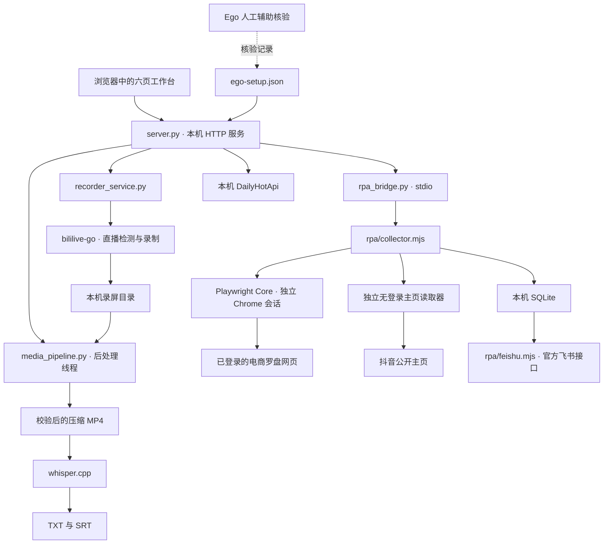

# 架构与数据边界

核对日期：2026-11-09。当前产品是 macOS Apple Silicon 上的本机服务，网页是操作入口。GitHub 用于源码和版本管理；录制与采集进程运行在用户电脑上。

## 运行结构

图中 Ego 只表示现有人工辅助核验与记录读取。自动 Ego 后台适配、千川定时采集和完整复盘尚待实现，不能从此图推断已经贯通。

## 代码职责

| 文件 / 目录 | 职责 |
|---|---|
| `直播操盘台.html` | 主布局、直播监控、热点、录屏列表、数据源说明、运行设置及共享 UI 方法 |
| `rpa-ui.js`、`rpa-ui.css` | 罗盘账号、场次、指标、趋势、导出及 Ego 核验记录卡片 |
| `feishu-ui.js`、`feishu-ui.css` | 飞书目标表、应用配置、同步开关、检查及错误展示 |
| `server.py` | 静态资源、同机服务适配、设置、媒体文件服务和 API 路由 |
| `start_dashboard.py`、`启动直播操盘台.command` | 检查端口和健康状态，启动工作台并打开网页 |
| `recorder_service.py` | 录制器进程归属、并发启动去重、配置生成、停止 / 重启保护 |
| `media_pipeline.py` | 文件稳定性检测、压缩、解码校验、按设置删除原件、转写及任务记录 |
| `flv_recovery.py` | 只读检查 FLV 标签及 AVC 长度，仅隔离一个损坏的末尾视频包 |
| `rpa_bridge.py` | Python 与 Node 采集器的私有 JSON stdio 通道、请求关联和超时 |
| `rpa/engine.mjs` | 每个本地账号的持久化 Chrome 会话、网页同会话只读请求 |
| `rpa/model.mjs` | 固定请求目标、响应校验、场次识别、指标与商品规范化 |
| `rpa/douyin-profile.mjs` | 抖音主页嵌入状态的有限提取与房间字段筛选 |
| `rpa/collector.mjs` | 调度、账号身份校验、单账号串行采集、暂停和错误状态 |
| `rpa/store.mjs` | SQLite 账号、场次、采样、事件和保留策略 |
| `rpa/feishu.mjs` | 飞书访问令牌、字段检查、稳定同步键、持久化写入及重试 |
| `tests/` | Python 单元 / HTTP 测试及 Node 内存 / 临时库测试；业务 API 使用测试夹具 |

依赖版本和启动命令以根目录安装说明与依赖清单为准。Python 服务使用标准库；罗盘模块需要 Node.js 24+、Playwright Core 和 Chrome。录制、压缩、转写、热点是独立的本机组件，源码 checkout 不代表这些程序和模型已经安装。

## 六页与本机接口

| 页面 | 主要数据 / 动作入口 | 目前边界 |
|---|---|---|
| 直播监控 | `/api/accounts`、`/api/recorder/state`、录制器动作接口 | bililive-go 提供直播与录制状态，不提供真实成交指标 |
| 经营数据 | `/api/rpa/state`、`/api/rpa/session`、账号动作、`/api/rpa/feishu/*`、`/api/rpa/ego/state` | 罗盘自动采集为今日场次；Ego 状态为最近核验记录 |
| 热词洞察 | `/api/hotwords` | 当前抖音热点榜及过滤，非搜索量、词库生成或模型关键词 |
| 字幕检索 | `/api/session-search?q=...&limit=50` | 本机 SRT 检索；返回片段内时间、命中文本、字幕链接及相对录屏路径；无经营场次 ID 或网页视频播放 |
| 录屏定位 | `/api/recordings/reveal`、`/api/recordings/open-directory` | 本机可信请求调用 Finder；检查路径在保存目录内且文件存在 |
| 场次复盘 | `/api/sessions`、`/api/media/jobs`、`/api/media/retry`、录屏 / 文本文件服务 | 当前为文件、重试及末尾残包恢复视图，完整复盘待开发 |
| 数据源接入 | `/api/status` | 真实服务状态和说明卡混合，未接入项必须保持明确标识 |
| 运行设置 | `/api/settings`、`/api/choose-recording-directory`、`/api/recorder/*` | 本机目录和进程操作；目录选择使用 macOS 系统能力 |

默认工作台入口是 `http://127.0.0.1:8765`；录制器和热点服务也使用回环地址。静态资源采用白名单，运行数据不是静态网站资源。录屏服务支持 HTTP Range，限制在配置的录屏根目录内；转写文件由独立目录提供。

### 主页开播检测

直播监控可保存标准抖音主页链接或 `v.douyin.com` 主页短链。每 60 秒由 Node 采集器在独立、无登录态的 Chrome 页面读取公开主页数据；不复用罗盘窗口或其 Cookie。优先检查网页用户资料响应，响应不可用时只从当前主页明确的嵌入状态提取 `room_data`。只有直播状态明确且 `web_rid` 是有效房间号时，才会将 `https://live.douyin.com/<web_rid>` 注册到 bililive-go。明确离线时继续轮询；缺字段、未知状态、验证页、限流和页面结构变化均显示检测错误，不当作离线。账号暂停后不再查询，录制中的旧房间不会因主页切换而被停止。

这使用的是抖音网页端数据，不是官方承诺稳定的开放 API；页面或接口变化、限流和无效主页会显示为检测错误。监测新主页默认关闭，需用户在账号详情中手动开启。bililive-go 仍只负责直播间状态与录制，不提供观看或成交指标。

当前不是公开多用户 Web 服务。外网部署需要另行设计身份认证、权限隔离、HTTPS、作业隔离与存储服务，不能简单改成监听所有网卡。现有 RPA 和录制器控制复用 Host / Origin 校验；新增敏感接口必须按同一规则检查，不能假定所有旧路由已经具备相同保护。

## 数据流和身份

### 罗盘

每个本地账号对应独立浏览器会话。采集先读取身份并与已保存的账号 ID 比较，发现不匹配停止本轮，避免把另一个账号数据写入原账号。之后读取今日场次，每轮优先处理最多 3 个场次的基础、核心指标和商品数据。

采集周期可设置为 30–600 秒；失败区分登录、限流、部分数据失败等状态。浏览器窗口关闭会暂停相应账号。暂停阻止后续写入；已存在的历史数据保留。

ID 保持字符串；数字超出安全精度时拒绝错误入库。指标保留原值、显示值和明确提供的单位；缺失显示“—”，不能默认为零。罗盘趋势只包含本机保存的采样；数据库最多保留 30 天、每场最多 1000 份快照，界面展示最近 120 份。

采集使用已登录网页的固定只读请求，这不是官方支持的开放集成 API 承诺。网页接口可能变化，变化应显示错误并保留已有快照。程序不执行外部分析材料中的任务脚本。

### 千川与历史报表

已有人工核验确认某历史场次的罗盘页面存在“千川消耗”，对应响应可读。该结论不能直接扩展到所有账户、所有时间段或所有趋势接口。

正式接入前需定义账号 / 广告账户 / 场次映射、字段单位、归因范围、日期范围、累计与分段语义和数据完成状态。已见趋势接口可能只返回局部时间窗口，不得用最后一点或局部求和代替全场金额。现有 `rpa/model.mjs` 没有消费千川字段，`collector.mjs` 也没有消耗任务。

历史回填应独立于今日轮询，采用有上限的任务、分页、进度与去重，不要使历史任务阻塞直播采样。具体表结构和 API 在实现时补充，当前不宣称它们存在。

### 飞书

飞书使用官方应用访问令牌与多维表格接口。配置保存后暂停自动同步，检查权限后再开启。只同步用户选择的账号，之后新增账号不自动进入范围。

稳定键由账号 UID 与直播间 ID 构成；每场在目标表保留最新快照。写入尝试和幂等 token 在本机 SQLite 持久化；网络故障或重启后先检查现有行再恢复写入。发现多个匹配行或不兼容字段时报告冲突，不擅自删除用户记录。

已有读取检查不等于写入成功。标准字段缺失时首次同步会补充；长 ID、金额单位和缺失值按文本 / 原始 JSON 保存。目标表、应用授权及真实写入验收仍由部署环境完成。

### 录制与后处理

录制器先把流保存为本地文件。后处理等待文件稳定且未被占用，串行执行压缩；通过全片解码检查后才允许按设置删除源文件，并再次确认源文件未变化。压缩、校验或删除出错均报告状态，避免把无效输出当成成功。

转写使用校验后的压缩文件生成 TXT 和 SRT。没有转写程序或模型时，压缩仍可完成并保留视频。转写结果放在单独目录，不随源录屏删除。压缩产物不会再次参与压缩扫描。

后处理轮询默认 30 秒，文件至少 60 秒未修改后才进入稳定性检查。重试接口仅接受已有任务 ID 和布尔恢复选项，执行 Host / Origin 校验；重复提交排队或处理中的任务不创建新任务。禁用处理时不接受重试、不启动下一任务，正在运行的任务完成当前流程。

任务持久保存源文件身份、压缩完成及产物身份。服务重启把处理中任务恢复为排队，保留原任务和产物；已压缩任务重新严格校验现有视频再继续转写，不重复压缩或依赖已删除原件。输出缺失、变动或源文件路径不在当前保存目录内时明确失败。删除前持久记录意图，进程在删除后退出仍可恢复清理状态。正常关闭有界终止后处理自己的子进程并保留排队任务，不操作录制器进程。

TXT/SRT 在临时目录中同时生成后，作为整目录原子发布到 `transcripts/_jobs/<任务 ID>/<尝试 ID>/<账号目录>/`。按任务隔离同名文件，发布清单允许恢复“文件已发布、任务状态尚未写回”的中断；只有文本但没有字幕时重新生成一组，保留旧产物。

末尾残包恢复由网页单独触发：只读检查 FLV 结构和所有 H.264 包长度；仅允许一个异常末尾包及可选结束标签，拒绝中间损坏、非 H.264、错误标签边界和正在录制的文件。仅把异常包前的字节流送入严格压缩，再完整解码校验。损坏原件始终保留，即使正常压缩配置为清理原件；任务记录损失字节、包时间和恢复原因。该路径不拼接直播片段、不补回未接收画面，完整场次关联及合并仍待开发。

## 存储与仓库边界

以下名称相对于运行数据根目录 `LiveOps`，而非仓库目录；录屏目录可以由用户另行选择。

| 数据 | 位置 / 形式 | 是否提交 Git |
|---|---|---|
| 应用源码、虚构夹具、安装说明 | 仓库 | 是 |
| 罗盘账号、场次、快照、飞书配置与重试 | `rpa/data.sqlite` | 否 |
| 登录会话 | `rpa/profiles/` | 否 |
| 监控账号和运行设置 | `accounts.json`、`dashboard-settings.json`、`plugin-settings/` | 否 |
| 录屏与压缩 MP4 | `recordings/` 或用户指定目录 | 否 |
| 文本及字幕 | `transcripts/` | 否 |
| 核验状态和真实响应 | `ego-setup.json`、`ego-evidence/` | 否 |
| 程序、模型、日志、备份 | `plugins/`、`tools/`、`logs/`、`backups/` | 否 |

密钥不返回网页、不写入 Git 或普通日志。当前系统用户仍能读取其本机运行数据；如需多用户隔离，必须新增设计。跨电脑同步源码时需重新安装组件和登录，不能复制浏览器会话当作默认迁移方案。

Obsidian 保存功能进度和交接说明；写进同步目录不等于另一台电脑已收到文件，也不等于本机网页服务已经迁移。

## 扩展约定与验证

1. 新数据源先有固定请求范围、身份核对和真实样例，再实现字段规范化；不要把任意 URL 或脚本执行器暴露给网页。
2. 数据采集与外部写入分开；无权限、无数据、尚未核验和服务离线分别表示。
3. 接口或进程可能失败时保留可恢复状态，避免重复录制、重复同步和误删文件。
4. 测试不依赖真实账号或生产数据；真实验收另记时间、场景和结果，敏感样例不提交仓库。
5. 改动涉及任务执行、文件删除、同步幂等或身份隔离时运行相关测试；界面按钮需有浏览器实际操作验收。

剩余开发顺序、每个页面的完成标准与用户依赖见 [ROADMAP.md](ROADMAP.md)。
